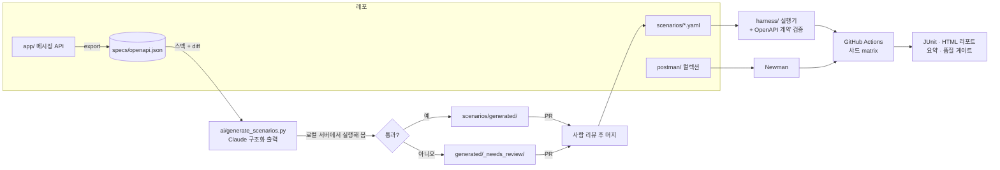

# regression-pipeline-template

메시징 Platform API를 대상으로 한 **회귀 테스트 파이프라인 템플릿**입니다.
같은 API를 두 세대의 방식으로 검증합니다.

| | v1 · Postman 파이프라인 | v2 · 코드 하네스 + AI |
| --- | --- | --- |
| 테스트 정의 | Postman 컬렉션 (JS assertion) | YAML 시나리오 + pytest 코드 |
| 실행 | Newman | pytest (샤드 병렬) |
| 검증 범위 | 상태코드, 필드 값, 응답 시간 | + **OpenAPI 계약**, 페이지 전체 순회, 동시성, 멱등성, 경계값 |
| 시나리오 작성 | 사람 | 사람 + **Claude 초안 → 자체 실행 검증 → 사람 리뷰** (구독: Claude Code / CI: API) |
| CI | Jenkins | GitHub Actions (Jenkinsfile도 제공) |

v1은 실무에서 운영했던 Postman → Newman → Jenkins 구조를 옮긴 것입니다.
v2는 그 구조에서 부딪힌 한계를 풀기 위해 만들었습니다. 컬렉션으로는 반복·동시성 검증이 어렵고,
스펙과 테스트가 따로 놀고, 시나리오 작성이 병목이었습니다.

## 데모 영상 (30초)

https://github.com/sso-jeong/regression-pipeline-template/raw/main/docs/demo.mp4

[▶ docs/demo.mp4](docs/demo.mp4): `./demo.sh`를 녹화한 영상입니다. Claude를 기다리는 구간은 10배속으로 줄였습니다.

1. 전체 회귀 통과 (18 passed)
2. 읽음 처리 버그를 심으면 어느 스텝에서 무엇이 달랐는지 출력
3. Claude Code가 시나리오 초안 5건을 만들고, 로컬 서버에서 실행해 통과·검토로 분류
4. AI 시나리오만 회귀 훈련에 돌리면 pagination·idempotency는 잡고 unread는 놓침
5. v1: 같은 API를 Postman 컬렉션 + Newman으로 검증 (26 assertions)

## 구조



```
app/main.py                 테스트 대상: 사용자·채팅방·메시지·읽음 API (인메모리)
specs/openapi.json          서버 코드에서 뽑은 계약. 바뀌면 test_spec이 잡는다
harness/
  scenario.py               시나리오 YAML 형식 (사람·AI 공용)
  runner.py                 스텝 실행, 변수 저장/치환, 부분 일치, 실패 시 요청·응답 기록 출력
  contract.py               모든 응답을 OpenAPI (메서드, 경로, 상태코드) 스키마와 대조
  server.py                 대상 서버 기동 또는 BASE_URL로 원격 환경 연결
scenarios/                  사람이 쓴 시나리오. generated/는 AI 초안 중 리뷰를 통과한 것
tests/
  test_scenarios.py         YAML 시나리오 → pytest 케이스 (tags → 마커)
  test_messaging.py         코드로만 쓸 수 있는 검증: 페이지 순회, 동시 전송 50건, 멱등 재전송, 경계값
  test_spec.py              스펙 드리프트 검사
  test_ai_pipeline.py       AI 생성기 후처리 검증 (고정 응답, API 호출 없음)
ai/generate_scenarios.py    Claude로 시나리오 초안 생성
postman/                    v1 컬렉션
tools/summarize_junit.py    샤드별 JUnit → 마크다운 요약, 실패 시 exit 1
.github/workflows/          regression.yml (PR·push·야간), ai-scenarios.yml (스펙 변경 시 초안 PR)
Jenkinsfile                 같은 파이프라인의 Jenkins 버전
```

## 실행

```bash
python3.12 -m venv .venv && . .venv/bin/activate
pip install -r requirements.txt

pytest                       # 전체 (서버는 자동으로 빈 포트에 뜬다)
pytest -m smoke              # 스모크만
BASE_URL=https://stg.example.com pytest -m smoke   # 이미 떠 있는 환경 대상

# v1
uvicorn app.main:app --port 8000 &
npx newman@6.2.1 run postman/messaging-regression.postman_collection.json --env-var baseUrl=http://127.0.0.1:8000
```

## 회귀 훈련: 버그를 넣으면 잡히는가

`INJECT_BUGS`로 서버에 실제로 있을 법한 회귀를 심을 수 있습니다.
Actions에서는 **Run workflow → inject_bugs** 입력으로 같은 훈련을 돌립니다.

| 주입 버그 | 내용 | 잡는 테스트 |
| --- | --- | --- |
| `pagination` | 커서 다음 메시지를 한 건 건너뜀 | `test_pagination_…`, `test_idempotent_…`, `SC-MSG-001` |
| `idempotency` | 같은 Idempotency-Key 재전송이 중복 저장됨 | `test_idempotent_…` |
| `unread` | 읽음 처리를 무시하고 전체를 안 읽음으로 셈 | `test_unread_…`, `SC-READ-001` |

```bash
INJECT_BUGS=unread pytest
```

실패하면 어느 스텝에서 무엇이 달랐는지와 그때까지의 요청·응답이 함께 나옵니다.

```
[SC-READ-001] 8번째 스텝 'bob 안 읽음 0' 실패
  - $.unread_count: 0 기대, 실제 2

--- 실행 기록 ---
> POST http://127.0.0.1:50619/v1/users  (alice 생성)
  body: {"name": "alice"}
< 201 {"id": "u_16a73da9ef", "name": "alice"}
...
```

## AI 시나리오 생성

```bash
# Claude 구독만 있으면: 로컬 Claude Code CLI로 실행
python ai/generate_scenarios.py --engine claude-code --count 5

# API 키가 있으면: Anthropic SDK로 실행 (CI의 ai-scenarios.yml이 이 방식)
pip install -r requirements-ai.txt
ANTHROPIC_API_KEY=... python ai/generate_scenarios.py --engine api --count 5 --diff-base origin/main

python ai/generate_scenarios.py --dry-run     # 프롬프트만 확인
```

1. 스펙, 변경 diff, 기존 시나리오 목록을 Claude에 줍니다. 기존 목록을 주는 건 중복을 피하기 위해서입니다.
2. 응답 형식은 JSON 스키마로 고정합니다. API는 구조화 출력, Claude Code는 `--json-schema`를 씁니다. 형식이 맞지 않는 초안은 버립니다.
3. 초안마다 로컬 서버에 **실제로 실행**합니다.
   - 통과하면 `scenarios/generated/`에 넣고,
   - 실패하면 `_needs_review/`에 넣고 실패 이유를 주석으로 붙입니다. 실패는 시나리오가 틀렸을 수도 있고 서버 결함일 수도 있어서, 사람이 판단합니다.
4. 결과는 PR로 올라갑니다. 회귀에 넣을지는 리뷰에서 결정합니다.

### 실제 실행 결과 (2026-11-25, claude-opus-5-5 via Claude Code)

`scenarios/generated/`의 5건이 이때 만든 것입니다. 입력 7.6K / 출력 6.7K 토큰, 49초가 걸렸고, 5건 모두 서버에서 통과했습니다.
같은 5건을 회귀 훈련에 돌린 결과가 이 방식이 왜 사람 리뷰를 거쳐야 하는지 보여 줍니다.

| 주입 버그 | AI 시나리오 5건 | 사람이 쓴 시나리오·테스트 |
| --- | --- | --- |
| `pagination` | 3건 실패 → 잡음 | 잡음 |
| `idempotency` | 1건 실패 → 잡음 | 잡음 |
| `unread` | **못 잡음** (읽음 영역 시나리오 없음) | 잡음 |

AI는 페이지네이션과 멱등성은 잘 짚었지만 읽음 처리는 다루지 않았습니다.
버그 주입으로 커버리지의 빈틈을 확인하고, 빈 곳은 사람이 메웁니다.

### 분류 로직 테스트

`tests/fixtures/ai_response.json`은 통과·검토·버림이 모두 나오도록 만든 고정 응답입니다. API 호출 없이 후처리를 검증합니다.
그중 "공백만 있는 이름은 거절해야 한다"는 초안은 서버가 실제로 공백 이름을 허용하므로 검토 대기로 갑니다.
스펙에 `min_length=1`만 있어서 생긴 구멍으로, 기획 확인이 필요한 사례입니다.

## CI

`regression.yml`은 PR, main push, 야간(03:00 KST), 수동 실행 때 돕니다.

1. `lint`: ruff
2. `api-tests` (matrix 3샤드)와 `newman`이 병렬로 돕니다. 샤드마다 자기 서버를 띄우므로 서로 간섭하지 않습니다.
3. `report`: 모든 JUnit을 모아 Job Summary에 요약을 쓰고, 실패가 있으면 여기서 막습니다.

## 관련 레포

- [qa-strategy-pack](https://github.com/sso-jeong/qa-strategy-pack): 스모크 체크리스트, Go/No-Go 기준
- [incident-rca-pack](https://github.com/sso-jeong/incident-rca-pack): 결함 리포트, RCA 템플릿
